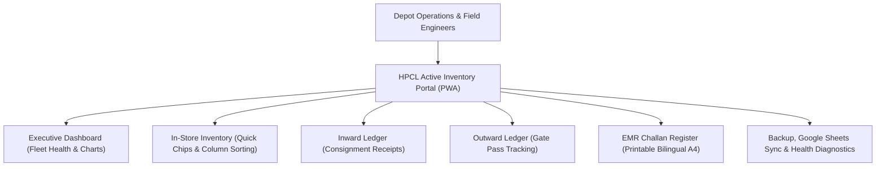

# HPCL Active Inventory Portal

**Hindustan Petroleum Corporation Limited (HPCL)**  
**Storage Facility:** Desur IRD Depot, Belgaum Regional Office (RRO)  
**Baseline Date:** January 1, 2026  
**Technology:** Enterprise Progressive Web Application (PWA), HTML5, CSS3, Vanilla JavaScript, SheetJS, Chart.js, Google Apps Script.

---

## 📌 Executive Overview

The **HPCL Active Inventory Portal** is a production-grade inventory control and dispatch authorization system engineered for depot officers, stores in-charge, and field engineers. Operating entirely client-side with persistent browser database storage (IndexedDB / LocalStorage) and optional two-way Google Sheets cloud auto-sync, it eliminates manual reconciliation delays and delivers instant, offline-capable tracking of fuel dispensing equipment.



---

## 🚀 Key Features

### 1. Executive Dashboard & Fleet Analytics
- **Live Reconciliation Counters**: Real-time counts for Active Depot Stock, Pressure DUs (New vs. Used), and Submersible Pumps (0.75 HP vs. 1.5 HP).
- **Brand Distribution Charts**: Interactive Chart.js analytics for manufacturers (**Gilbarco Veeder-Root**, **Tokheim**, **Midco**, **Wayne**, **Florite**).
- **Recent Activity Feed**: Real-time timeline of incoming arrivals and outgoing dispatches.

### 2. In-Store Stock Management
- **Quick Views Chips**: 1-click filters for `All Stock`, `Dispensing Units`, `New DUs`, `Used DUs`, `STP Pumps`, and `Unserviceable`.
- **Global Search (`Ctrl + K`)**: Omnibar search indexing serial numbers, models, vendors, and locations.
- **Bi-Directional Sorting**: Clickable table headers with ascending/descending indicators across all columns.
- **1-Click Serial Copy**: Click any serial number to copy it directly to the clipboard.
- **Export View**: Download currently filtered records directly into Excel CSV format.

### 3. Comprehensive Material Ledgers
- **Inward Ledger**: Detailed records of all incoming materials received from factories and inter-depot transfers.
- **Outward Ledger**: 4 distinct sub-ledgers tracking material dispatches with Gate Pass reference numbers:
  - *Dispensing Units (DUs)*
  - *Submersible Turbine Pumps (STPs)*
  - *Tanks (16 KL / 20 KL)*
  - *Automation & Other Spares*

### 4. Official Bilingual EMR (Equipment Movement Record) Issuance & Printing
- **Challan Generation**: 1-click EMR creation directly from active in-store stock.
- **Official Print Preview**: Bilingual corporate masthead (*हिन्दुस्तान पेट्रोलियम कॉर्पोरेशन लिमिटेड* / *HINDUSTAN PETROLEUM CORPORATION LIMITED*).
- **Statutory Safety Compliance**: Aligned with OISD and PESO depot regulations.
- **4 Formal Signature Blocks**:
  1. *Issued / Dispatched By* (Vishal — Junior Executive - RE)
  2. *Checked & Verified By* (Vinita Kumari — Manager - RE)
  3. *Approved By* (Praise K James — Manager - RE Head)
  4. *Receiver / Transporter Acknowledgement*
- **A4 Formatted**: Clean single-page printing suppressing browser URL headers and footers.

### 5. Universal Excel & CSV Import Engine
- **Flat Table Recognition**: Accepts direct spreadsheet uploads where Row 1 is the header row.
- **Automatic Column Detection**: Intelligently identifies columns regardless of positioning.
- **In-Place Updates**: Existing equipment serials are updated with latest status and remarks.
- **New Machine Arrivals**: Automatically adds newly arrived machines to depot stock and creates an audit entry in the Inward Ledger.
- **Downloadable Templates**: 1-click download of official DU and STP Excel templates inside the portal.

### 6. Cloud Sync & Offline PWA Capabilities
- **Two-Way Google Sheets Auto-Sync**: Real-time cloud synchronization via Google Apps Script Web App.
- **Connection Latency Tester**: Instant endpoint ping to verify Google Sheets reachability.
- **Progressive Web App (PWA)**: Auto-install popup on launch for Windows, Mac, Android, and iOS devices with offline Service Worker caching.

---

## 📂 Repository File Structure

```text
├── index.html                 # Page markup (all screens and dialogs)
├── css/app.css                # Design system: colours, type, layout, print
├── js/app.js                  # Stock, ledgers, EMR, import/export, Google Sheets sync
├── js/dispatch.js             # Dispatch letters, depot dispatch, photo capture/storage/upload
├── js/baseline-data.js        # 01/01/2026 baseline inventory (used only on first run)
├── google_apps_script.js      # Apps Script for Google Sheets push/pull + Drive photo upload
├── manifest.json              # PWA manifest
├── sw.js                      # Service worker (offline support)
├── HPCL.png, favicon.*, icon-*.png, apple-touch-icon.png
└── README.md
```

---

## 🚚 Dispatch workflow (office → depot → photo proof)

1. **Office issues a dispatch letter** (Dispatch letters → *Issue dispatch letter*). Pick the DUs / STPs from stock, add other material lines (cable, nozzles…), the RO, the vendor who will collect, and the purpose. The letter gets a running number such as `DL/DESUR/2026-27/001` and prints as a formal HPCL letter. The listed assets are **reserved**: they show a *Reserved* tag in stock and can't be put on another letter.
2. **Depot records the dispatch** when the material actually leaves (*Record dispatch* on the letter). Staff take photos with the phone camera, of the loaded vehicle and the serial plates. At least one photo is required. The depot name, date and time are stamped on every photo. They enter the vehicle number and who dispatched it.
3. The app then **creates the EMR automatically**, moves the assets to the outward ledger, and marks the letter *Dispatched*. The overview's dispatch line shows letters issued, waiting at the depot (yellow hazard band), and dispatched with photo.
4. Photos can also be added later to any EMR (camera icon on the EMR list). EMRs without a photo are flagged.
5. Cancelling an EMR returns its assets to stock and puts its letter back to *Waiting at depot*. Cancelling a letter releases the reserved assets.

**Where photos are kept:** on the device (IndexedDB, about 150–300 KB each after resizing). When an Apps Script `/exec` URL is saved, they are uploaded to Google Drive (`HPCL Dispatch Photos/<EMR no>`), so office devices can see them too. JSON backups can include the photos.

> Sync is "last push wins": each push replaces the sheet with that device's data. Before working on a second device, **Pull from Sheets** first so you don't overwrite the other device's letters or dispatches.

---

## 🌐 Deployment (GitHub Pages)

Because this application is built with modern, zero-dependency client-side technologies, it can be hosted directly on **GitHub Pages**:

1. Push this repository to GitHub.
2. In your repository on GitHub, navigate to **Settings** $\rightarrow$ **Pages**.
3. Under **Branch**, select `main` (root) and click **Save**.
4. Your application will be live at:
   ```text
   https://<your-username>.github.io/<repository-name>/
   ```

---

## 🛠️ Google Sheets Integration Setup

To link your Google Sheet with the portal for real-time cloud sync:
1. Open your target Google Sheet.
2. Click **Extensions** $\rightarrow$ **Apps Script**.
3. Replace any existing code with the contents of [`google_apps_script.js`](./google_apps_script.js).
4. Click **Deploy** $\rightarrow$ **New deployment**.
5. Select type **Web app**:
   - *Execute as*: **Me**
   - *Who has access*: **Anyone**
6. Copy the deployed Web App URL.
7. In the portal, navigate to **Backup & Sync**, paste the URL into the **Google Sheet URL or Web App Link** box, and check **Enable auto-sync**.

---

## 📝 Changelog

### v3.0 (November 2026)
- **New interface**: light theme by default for use in the yard (dark mode kept), Barlow / Barlow Condensed type, a dispatch-progress strip on the overview, stock and EMR lists shown as cards on phones, and a bottom navigation bar on mobile.
- **Dispatch letters** issued by the office, with asset reservation, a printable letter (with a depot endorsement box) and CSV export.
- **Photo proof of dispatch**: camera capture, automatic resize and date/time stamp, a gallery per EMR, an *EMRs missing photo* filter, and upload to Google Drive.
- EMR numbers now run in sequence per day (`EMR-20261127-001`) instead of being random.
- The "New DUs" / "Used DUs" chips now count DUs only (they previously included STPs).
- Vendor and RO name suggestions are offered from earlier dispatches.
- Code split into `css/`, `js/` files. The service worker fetches the app's own files from the network first, so an update is never mixed with old cached code.
- **Apps Script v3.0: redeploy required.** It adds the `Dispatch_Letters` sheet, new EMR columns, and the photo upload. Redeploying asks for Google Drive permission.

### v2.1 — November 2026
**Data integrity**
- Multi-asset EMRs now survive a Google Sheets push → pull. The full asset list is stored in a new `items_json` column on the `EMR` sheet; older flattened EMRs are rebuilt from the DU/STP outward ledgers.
- Cancelling an EMR now returns each asset with its **original condition, receipt date and remarks** (previously every returned asset was reset to "New" with today's date).
- Cancelling an EMR removes the outward-ledger row belonging to *that* EMR, not just the first row with the same serial.
- Dates no longer shift back one day in India: Excel imports, Sheets pulls and "today" defaults all use the local (IST) calendar date.
- Records pulled from Sheets with numeric values (serials, EMR numbers, vendors) no longer break the EMR page, search or printing.
- Duplicate or missing S.No values are repaired on load so the Edit button always opens the right asset.
- Adding an asset whose serial is already in store is blocked; recording a manual outward entry for a serial that isn't in store asks for confirmation.

**Backup, export & sync**
- New **Restore JSON** button on Backup & Sync to load a backup (e.g. to move data to another device).
- CSV exports no longer cut off at a `#` in remarks, all fields are quoted correctly, STP rows no longer show `undefinedHP`, and **Export View** now matches exactly what the In-Store table shows.
- Pulling from Sheets asks for confirmation (with record counts) before replacing local data.
- Auto-push only runs for an Apps Script `/exec` URL; a plain spreadsheet link is shown as **Sheet Linked (Pull Only)** instead of a misleading "Connected".
- Rapid successive saves are pushed to Sheets once (1.5 s debounce).

**Security & polish**
- All data from Sheets / Excel / forms is HTML-escaped before display (inventory, ledgers, EMR list and printed voucher).
- Unserviceable DUs recorded as text (e.g. "UNSERVICEABLE") are counted in the status chart; STP HP no longer shows as "1.5 HP HP".
- Chart.js pinned to 4.4.1; service-worker cache bumped to `v3` so devices pick up the new version.

**Apps Script (`google_apps_script.js`) — redeploy required**
- Writes every cell as plain text (keeps leading zeros / long serials intact), returns dates as `DD/MM/YYYY`, adds a script lock against simultaneous pushes, and rejects malformed requests.
- To update an existing deployment without changing its URL: **Deploy → Manage deployments → ✏️ Edit → Version: New version → Deploy**.

---

## 📄 License & Attribution

Internal proprietary software developed for **Hindustan Petroleum Corporation Limited (HPCL)**, Desur IRD Depot, Belgaum Regional Office (RRO). All corporate logos and trademarks belong to HPCL.
