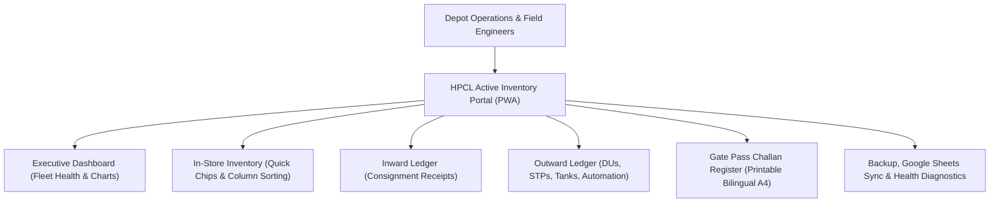

# HPCL Active Inventory Portal

**Hindustan Petroleum Corporation Limited (HPCL)**  
**Storage Facility:** Desur IRD Depot, Belgaum Regional Office (RRO)  
**Baseline Date:** January 1, 2026  
**Technology:** Enterprise Progressive Web Application (PWA), HTML5, CSS3, Vanilla JavaScript, SheetJS, Chart.js, Google Apps Script.

---

## 📌 Executive Overview

The **HPCL Active Inventory Portal** is a production-grade inventory control and dispatch authorization system engineered for depot officers, stores in-charge, and field engineers. Operating entirely client-side with persistent browser database storage (IndexedDB / LocalStorage) and optional two-way Google Sheets cloud auto-sync, it eliminates manual reconciliation delays and delivers instant, offline-capable tracking of fuel dispensing equipment.



---

## 🚀 Key Features

### 1. Executive Dashboard & Fleet Analytics
- **Live Reconciliation Counters**: Real-time counts for Active Depot Stock, Pressure DUs (New vs. Used), and Submersible Pumps (0.75 HP vs. 1.5 HP).
- **Brand Distribution Charts**: Interactive Chart.js analytics for manufacturers (**Gilbarco Veeder-Root**, **Tokheim**, **Midco**, **Wayne**, **Florite**).
- **Recent Activity Feed**: Real-time timeline of incoming arrivals and outgoing dispatches.

### 2. In-Store Stock Management
- **Quick Views Chips**: 1-click filters for `All Stock`, `Dispensing Units`, `New DUs`, `Used DUs`, `STP Pumps`, and `Unserviceable`.
- **Global Search (`Ctrl + K`)**: Omnibar search indexing serial numbers, models, vendors, and locations.
- **Bi-Directional Sorting**: Clickable table headers with ascending/descending indicators across all columns.
- **1-Click Serial Copy**: Click any serial number to copy it directly to the clipboard.
- **Export View**: Download currently filtered records directly into Excel CSV format.

### 3. Comprehensive Material Ledgers
- **Inward Ledger**: Detailed records of all incoming materials received from factories and inter-depot transfers.
- **Outward Ledger**: 4 distinct sub-ledgers tracking material dispatches:
  - *Dispensing Units (DUs)*
  - *Submersible Turbine Pumps (STPs)*
  - *Tanks (16 KL / 20 KL)*
  - *Automation & Other Spares*

### 4. Official Bilingual Gate Pass Issuance & Printing
- **Challan Generation**: 1-click Gate Pass creation directly from active in-store stock.
- **Official Print Preview**: Bilingual corporate masthead (*हिन्दुस्तान पेट्रोलियम कॉर्पोरेशन लिमिटेड* / *HINDUSTAN PETROLEUM CORPORATION LIMITED*).
- **Statutory Safety Compliance**: Aligned with OISD and PESO depot regulations.
- **4 Formal Signature Blocks**:
  1. *Issued / Dispatched By* (Vishal — Junior Executive - RE)
  2. *Checked & Verified By* (Vinita Kumari — Manager - RE)
  3. *Approved By* (Praise K James — Manager - RE Head)
  4. *Receiver / Transporter Acknowledgement*
- **A4 Formatted**: Clean single-page printing suppressing browser URL headers and footers.

### 5. Universal Excel & CSV Import Engine
- **Flat Table Recognition**: Accepts direct spreadsheet uploads where Row 1 is the header row.
- **Automatic Column Detection**: Intelligently identifies columns regardless of positioning.
- **In-Place Updates**: Existing equipment serials are updated with latest status and remarks.
- **New Machine Arrivals**: Automatically adds newly arrived machines to depot stock and creates an audit entry in the Inward Ledger.
- **Downloadable Templates**: 1-click download of official DU and STP Excel templates inside the portal.

### 6. Cloud Sync & Offline PWA Capabilities
- **Two-Way Google Sheets Auto-Sync**: Real-time cloud synchronization via Google Apps Script Web App.
- **Connection Latency Tester**: Instant endpoint ping to verify Google Sheets reachability.
- **Progressive Web App (PWA)**: Auto-install popup on launch for Windows, Mac, Android, and iOS devices with offline Service Worker caching.

---

## 📂 Repository File Structure

```text
├── index.html                 # Complete Single-Page Application (HTML, CSS Design System, Client JS)
├── google_apps_script.js       # Apps Script code for Google Sheets two-way Push & Pull API
├── manifest.json              # Web App Manifest for PWA installation
├── sw.js                      # Service Worker script for offline asset & network caching
├── HPCL.png                   # Official corporate logo and crest
├── favicon.ico                # Desktop browser favicon
├── favicon.png                # Modern high-res PNG favicon
├── apple-touch-icon.png       # iOS Apple Touch Icon (180x180)
├── icon-192.png               # Android PWA launcher icon (192x192)
├── icon-512.png               # High-res PWA splash icon (512x512)
├── .gitignore                 # Standard repository ignores
└── README.md                  # Project documentation & operating guide
```

---

## 🌐 Deployment (GitHub Pages)

Because this application is built with modern, zero-dependency client-side technologies, it can be hosted directly on **GitHub Pages**:

1. Push this repository to GitHub.
2. In your repository on GitHub, navigate to **Settings** $\rightarrow$ **Pages**.
3. Under **Branch**, select `main` (root) and click **Save**.
4. Your application will be live at:
   ```text
   https://<your-username>.github.io/<repository-name>/
   ```

---

## 🛠️ Google Sheets Integration Setup

To link your Google Sheet with the portal for real-time cloud sync:
1. Open your target Google Sheet.
2. Click **Extensions** $\rightarrow$ **Apps Script**.
3. Replace any existing code with the contents of [`google_apps_script.js`](./google_apps_script.js).
4. Click **Deploy** $\rightarrow$ **New deployment**.
5. Select type **Web app**:
   - *Execute as*: **Me**
   - *Who has access*: **Anyone**
6. Copy the deployed Web App URL.
7. In the portal, navigate to **Backup & Sync**, paste the URL into the **Google Sheet URL or Web App Link** box, and check **Enable auto-sync**.

---

## 📄 License & Attribution

Internal proprietary software developed for **Hindustan Petroleum Corporation Limited (HPCL)**, Desur IRD Depot, Belgaum Regional Office (RRO). All corporate logos and trademarks belong to HPCL.
